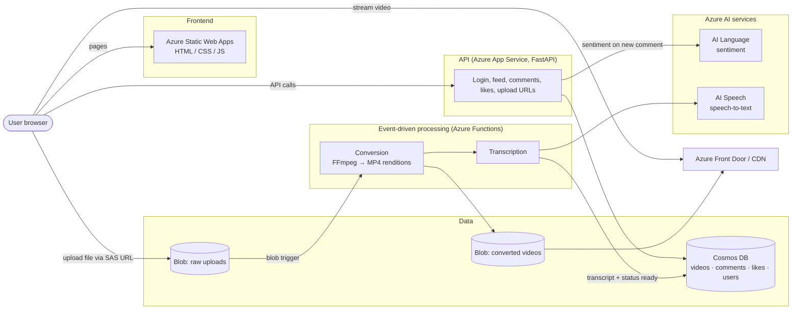
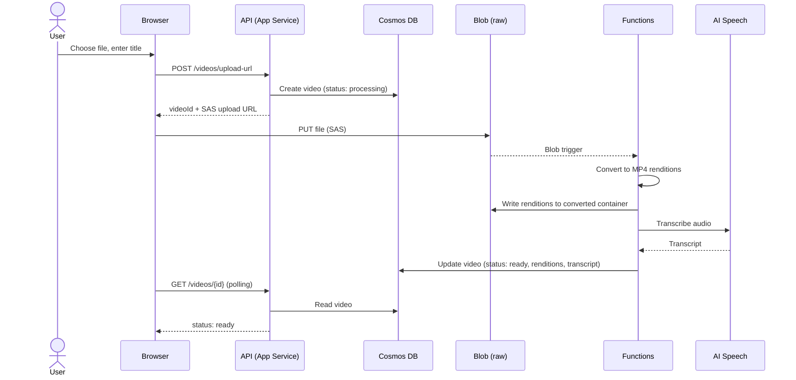
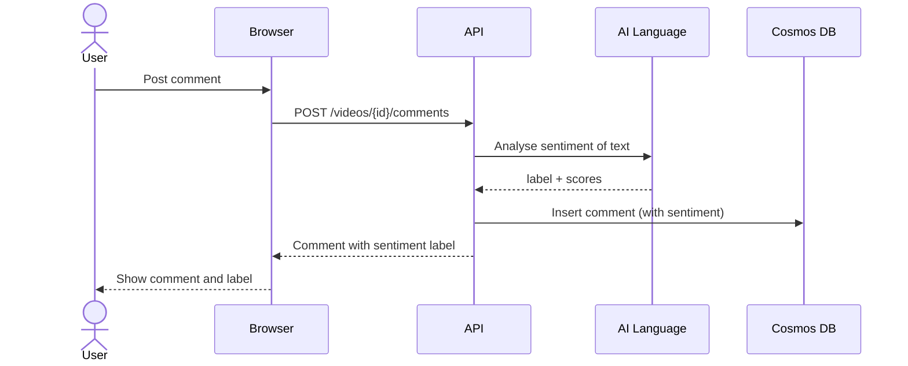
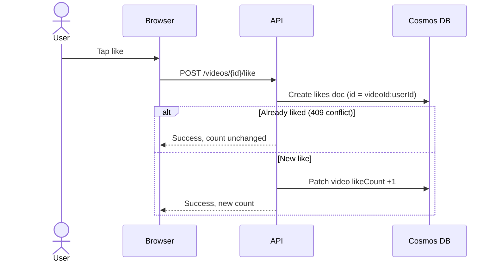

# Clipstream architecture

GitHub renders the Mermaid diagrams below directly.

## 1. System overview

## 2. Upload flow

Video bytes never pass through the API. The browser uploads straight to Blob Storage, and processing runs in the background.

## 3. Comment flow (with sentiment)

## 4. Like flow

## Container summary

| Container | Partition key | Used by |
|---|---|---|
| `videos` | `/id` | API (feed, upload), Functions (status, renditions, transcript) |
| `comments` | `/videoId` | API (post, list, sentiment summary) |
| `likes` | `/videoId` | API (like, unlike, "did I like this?") |
| `users` | `/id` | API (login) |
